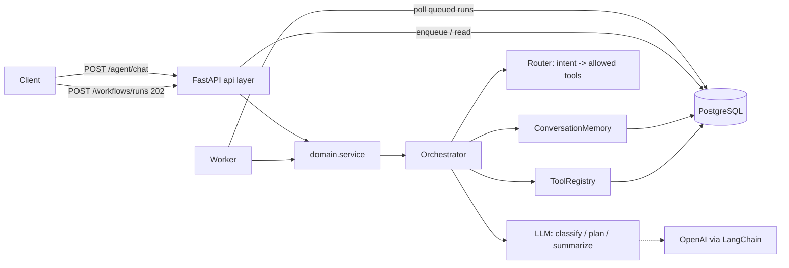

# AI Workflow Automation Platform (MVP)

FastAPI + PostgreSQL + LangChain/OpenAI agent platform. Requests are classified, routed to a workflow with a
tool allow-list, planned, executed step by step, summarised, and remembered. Runs offline with a deterministic
`FakeLLM` (default; used by all tests) or with OpenAI via LangChain (`LLM_PROVIDER=openai`).

## Layout
```
app/
  main.py                 FastAPI app, lifespan (init + seed DB)
  config.py               env-driven settings
  api/                    HTTP layer only: routes/{health,chat,documents,runs}.py, schemas.py, deps.py
  domain/                 router.py (intent->workflow+tool allow-list), orchestrator.py, service.py (run lifecycle)
  agents/                 llm.py (Fake + OpenAI/LangChain), prompts.py, tools.py, memory.py
  data/                   db.py, models.py (SQLAlchemy 2.0), seed.py
  infra/worker.py         queue consumer (DB-as-queue, SKIP LOCKED)
tests/{unit,integration,e2e}/   30 tests + 1 opt-in live-stack smoke test
infra/initdb/               creates the aiwf_test database for compose-based tests
docker-compose.yml  Dockerfile  Makefile  .env.example
docs/TEST_REPORT.md
```

## Architecture

**Data/model flow:** request -> memory.context() -> `classify` (intent) -> `route` (workflow + allowed tools) ->
`plan` (JSON steps) -> allow-list validation -> tool execution (errors captured per step) -> `summarize` ->
memory.add -> `workflow_runs` row (status, intent, steps, answer). Run status: `completed | partial | failed`.

**Safety properties:** tools are fixed parameterised functions (no LLM-written SQL); plans are filtered by a
per-workflow allow-list; steps capped by `MAX_AGENT_STEPS`; LLM JSON parsing degrades to `general`/no-op.

## Run locally
```bash
cp .env.example .env          # optional
make up                       # db + api (:8000) + worker   (docker compose up --build -d api worker)
curl -s localhost:8000/api/v1/agent/chat -H 'content-type: application/json' \
  -d '{"session_id":"demo","message":"Recommend what to reorder"}'
curl -s localhost:8000/api/v1/workflows/runs -H 'content-type: application/json' \
  -d '{"session_id":"demo","message":"show pending orders"}'     # then GET /api/v1/workflows/runs/{id}
```
OpenAI: `LLM_PROVIDER=openai OPENAI_API_KEY=sk-... make up`. Docs UI at `/docs`.

## Run tests
| Where | Command | DB |
|---|---|---|
| Local, no Docker | `pip install -r requirements-dev.txt && pytest -v` | in-memory SQLite |
| Docker (single compose) | `make test` (= `docker compose run --rm --build test`) | Postgres `aiwf_test` |
| Live-stack smoke | `make up && E2E_BASE_URL=http://localhost:8000 pytest tests/e2e/test_live_stack.py` | Postgres + worker |

## Production-like notes
- Run `api` with several uvicorn/gunicorn workers behind a load balancer; scale `worker` replicas horizontally (SKIP LOCKED is safe).
- Secrets via env/secret manager; managed Postgres; replace `create_all` with Alembic migrations (Phase 2).
- Add authN/Z, rate limiting, request IDs and structured logs/OTel traces before exposing publicly.
- Real-LLM runs are non-deterministic: keep CI on FakeLLM; run a small nightly eval set against OpenAI.

## Phases
1. **MVP (this repo):** 5 intents, 5 tools, DB memory, sync + async execution, guardrails, 3-tier tests.
2. Alembic, auth (JWT/API keys), pgvector RAG over documents, LLM-based document summaries, retries/timeouts, metrics.
3. Celery/SQS queue, multi-agent supervisor, human-approval steps for risky tools, streaming (SSE), eval harness with golden sets.
4. Multi-tenant isolation, cost budgets per tenant, prompt versioning + A/B, audit exports.

## End-to-end scenarios (all automated in `tests/e2e`, `tests/integration`)
| # | Input | Expected |
|---|---|---|
| 1 | Upload contract, "Analyze document N" (async) | `completed`, intent `document_analysis`, risks `["penalty","terminate"]` |
| 2 | "Recommend what to reorder" | `completed`, steps `get_inventory`->`recommend_actions`, "reorder 35 x SKU-100" |
| 3 | Same session: "Create a task: Reorder SKU-100 assign to alice" | task row created (alice), answer notes prior context |
| 4 | "Analyze document 12345" | `failed`, step `error` "not found", HTTP still 200/recorded |
| 5 | LLM proposes tool outside workflow | step `rejected`, nothing executed |
| 6 | "show pending orders" | count 3, total 389.5 |
| 7 | "hello" | `completed`, no tool steps |
